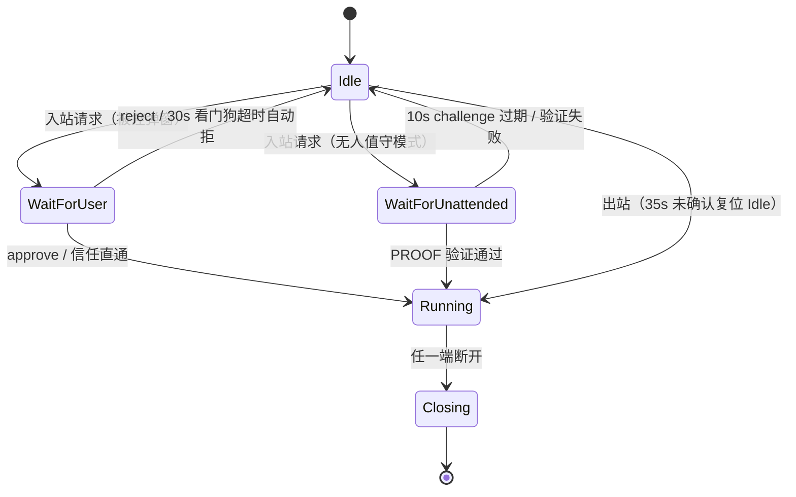

# Doc19 · 全量缺口清点与修订（v1.1）

> 日期：2026-10-30 ｜ 基线：双机联调通过（双向控制 / 输入同步 fps≈15 drop=0 / 弹窗封装完成）
> 定位：对 Doc01–Doc18 的缺口清点 + 补充需求全量并入 + 迭代路线。**每一条都标注现状实况**（✅已有 / ⚠️部分 / ❌未实现），杜绝"文档写了代码没有"。
> 方法：全部结论来自源码实读（含 文件:行号），非设计推演。

---

## 1. 补充清单逐条核对总表

| # | 清单条目 | 现状 | 实况 |
|---|---|---|---|
| 1.1 | 信任主键不用 IP | ✅ 天然免疫 | TrustStore 主键是**对方连接码**（code），非 IP（trust_store.hpp:24-25） |
| 1.1 | 信任条目带 device_id 绑定 | ❌ | 条目仅 `{code, name(trust_at 备注合并), trusted_at}` |
| 1.1 | 信任过期（7/30天） | ❌ | 无过期字段/逻辑（全码库无 expiry 命中） |
| 1.1 | 信任管理页（吊销/清空） | ⚠️ | `untrust()/set_note()` API 已有；**UI 入口未建** |
| 1.2 | 信任设备 device_id 变更拦截 | ❌ | 无 device_id 概念入信任链 |
| 1.3 | 请求超时自动拒 | ✅ | 30s 看门狗（清单假设 60s，实况 30s） |
| 1.3 | 锁屏状态自动拒绝 | ❌ | 无锁屏检测 |
| 1.4 | 黑名单 | ❌ | 全码库 blacklist 零命中 |
| 1.5 | 连接码 6~8 位可刷新 | ❌（口径修正） | 实况 **9 位纯数字固定派生**，无刷新/重置机制 |
| 1.6 | 回环拦截按 device_id | ⚠️ | 自连拦截存在（widgets_main 自连分支），判定口径待核 |
| 2.1 | 多显示器选择 | ❌ | 采集主屏单路 |
| 2.2 | UAC 安全桌面采集开关 | ❌ | 无 |
| 2.3 | 采集失败占位帧 | ⚠️ | X11 BadMatch 防崩已有；占位帧/心跳保持未做 |
| 2.4 | 画面缩放三模式/光标模式 | ❌ | 自适应单一模式；光标随帧合成（GDI 默认带光标） |
| 2.5 | 只读模式 | ❌ | 无 |
| 3.1 | 传输队列多文件并行 | ⚠️ | 单任务串行，无并行上限配置 |
| 3.2 | 同名文件覆盖三选项 | ❌ | 接收策略未实现（直接落盘） |
| 3.3 | 目录递归传输 | ❌ | 单文件 |
| 3.4 | 可执行后缀拦截 | ❌ | 无 |
| 3.5 | .scpart 临时文件+原子改名 | ⚠️ | 分片校验失败即中断（file_service.cpp:479-553）；临时文件原子改名未实现 |
| 3.6 | 剪贴板同步 | ⚠️ 协议已备 | `ClipboardSync=0x07`/`KeySync=0x08` 消息类型已定义，业务未实现 |
| 4.1 | 锁定本机键鼠/紧急解锁 | ❌ | 无 |
| 4.2 | 一键断开所有会话/断线重连窗 | ⚠️ | 双端可断开；重连窗口/提示未做 |
| 4.3 | Ctrl+Alt+Del 提示 | ❌ | 无特殊处理 |
| 4.4 | 水印帧内叠加 | ✅（清单担忧不成立） | watermark_painter 生成 QImage 在**推流帧内**叠加（别名+时间，半透白字深描边）——非 QML 层，截图绕不过 |
| 5.1 | 审计日志独立文件 | ⚠️ | 无人值守接入以 `LogLevel::Warn` + "audit" tag 写主日志（Warn 级 flush 即时落盘）；独立 audit.log 未分流 |
| 5.2 | 崩溃 dump 本地留存 | ✅ | crash_reporter（win32），不上外网 |
| 6.1 | 配置隔离/管理员锁定项 | ⚠️ | config.ini 9 个 section 已备；锁定项未做 |
| 6.2 | 双自启模式（GUI/headless） | ⚠️ | 注册表 CurrentUser + Linux autostart 已有；headless 服务模式未做 |
| 6.3 | 跨子网手动添加设备 | ❌ | 仅同子网 UDP 广播 |
| 6.4 | headless/GUI 互斥策略 | ⚠️ | 单实例守卫已有，双模式互斥规则未细化 |
| 7 | 错误文案映射表 | ❌ | UI 直出内部错误串（如 e.reason） |
| 8.1 | 平台错误→core 统一枚举 | ⚠️ | 部分接口返回码统一；采集/注入侧未全覆盖 |
| 8.3 | 录制/限速/域账号插件接口 | ❌ | 未预留（接口层可扩） |

**结论**：清单 60+ 条中 ✅8 / ⚠️14 / ❌38。清单里三处假设被实况推翻（1.1 主键、4.4 水印、1.5 码长），P0 优先级据此重排（§12）。

---

## 2. 协议与网络（实况）

### 2.1 TLV 帧布局（tlv.cpp:30-64）

```
 0               1               2               3
 +-------+-------+---------------+---------------+
 | MsgType (1B)  |  Body Length (4B, 大端)        |
 +---------------+---------------+---------------+
 |               Body (≤ kMaxBody)                |
 +------------------------------------------------+
```

- 头 5 字节：`1B MsgType + 4B BE BodyLen`；**无魔数、无版本号、无 CRC、无 seq/ack**（TCP 可靠性兜底）
- ⚠️ 缺口：版本协商无处安放（新旧版本互联不兼容时无法提示）→ P1 建议升级 `1B ver + 1B msg + 3B len` 或在 SessionCtrl 首包携带版本

### 2.2 MsgType 全表（msg_type.hpp:12-22）

| 值 | 名称 | 用途 |
|---|---|---|
| 0x01 | MouseKey | 键鼠事件 |
| 0x02 | ScreenFrame | 画面帧 |
| 0x03 | FileChunk | 文件分片 |
| 0x04 | SessionCtrl | 会话控制（请求/同意/拒绝/断开） |
| 0x05 | ConfigSync | 配置同步 |
| 0x06 | FileMeta | 文件元信息 |
| 0x07 | ClipboardSync | 剪贴板（**协议已备业务未实现**） |
| 0x08 | KeySync | 按键同步（同上） |

### 2.3 传输承载与会话多路复用（ws_transport.cpp:158-184）

- 承载：**WebSocket（TCP）单通道**，信令/画面/文件复用；WebSocket 天然消息边界 → 无粘包问题
- 低延迟：对 QWebSocket 内部 QTcpSocket 设 `LowDelayOption`（禁 Nagle，键鼠小包即时送达）
- 流控核心（bounded_queue.hpp:27-69）：
  - **画面帧** `push_overwrite`：满则丢最旧留最新 → 画面永不妨碍通道
  - **非画面帧**（信令/文件/键鼠）`push_wait`：满则等待重试 → 文件不被画面饿死
- 心跳：UDP 发现层 5s 周期；TCP 会话层依赖 WebSocket keepalive（应用层心跳间隔未显式配置 → P2 补）

### 2.4 UDP 发现（qt_udp_discovery.cpp:118-152）

- 报文：`magic 2B + alias_len 1B + alias + IPv4 4B + port 2B + version 2B + status 1B [+ 9B 连接码 TLV]`
- 周期 5s；仅同子网广播；离线判定：连续丢失标记灰卡（具体次数见 Doc07）
- ❌ 跨子网手动添加（VLAN 场景）：未实现 → P2

---

## 3. 安全与鉴权（实况 + 规划）

### 3.1 无人值守鉴权（unattended_authenticator）

| 参数 | 实况 |
|---|---|
| challenge | 16B 随机 nonce |
| proof | 32B = **HMAC-SHA256**（openssl_crypto.cpp:97-117） |
| 密钥派生 | **PBKDF2-HMAC-SHA256，100001 轮，32B key**（密码不直接做 key） |
| 存储 | `salt_hex + key_hex + verify_hash_hex` 三元组（非明文） |
| 防重放 | challenge **10s TTL + 一次性消费**（verify 后即失效） |
| 比较 | 常数时间比较（防时序侧信道） |

实况结论：鉴权算法面扎实，无需返工。

### 3.2 TrustStore 现状 vs 目标

- 现状：主键 = 对方 9 位连接码；字段 `{code, name, trusted_at}`；原子落盘；`is_trusted/trust/untrust/set_note` API 齐
- 差距（→P0）：①无 device_id 二次绑定（连接码撞码/冒用场景） ②无过期 ③无管理 UI ④无黑名单 ⑤连接码刷新会使信任失效——需联动设计

### 3.3 连接码（id_service.hpp 实况，修正清单口径）

- **9 位**纯数字（`xxh3_64(hostname+MAC+安装目录, kIdSalt)` 折叠 3×3 位），展示 `xxx xxx xxx`
- 指纹派生 → **固定不可刷新**（换机器/改 hostname 才变）；清单"手动刷新+旧信任失效"是**新需求**（→P1：引入随机码模式或显式重置，重置联动清空 TrustStore）
- 数字码 0~999999999 心跳扩展已备（code_number()）

### 3.4 待建安全面（P0/P1）

1. **黑名单**（by code）：SessionCtrl 请求直接丢弃不回包；黑白互斥黑优先
2. **锁屏拦截**：被控端锁屏（Win: WTS session lock；X11: xscreensaver 状态）时入站请求**自动拒绝**
3. **device_id 绑定**：心跳已带设备指纹原料，信任条目升级 `{code, device_fp_hash, trusted_at, expires_at}`
4. **回环判定口径统一**：比对连接码（自连=本机码）优先于 IP

---

## 4. 会话与采集

### 4.1 会话状态机（remote_session_service.hpp:48-66 实况）



- `kConfirmTimeoutSec=30`（被控确认看门狗）、`kOutboundWaitSec=35`（控制端等待）
- 审计点：无人值守接入成功写 Warn 级 audit tag（remote_session_service.cpp:915-918）

### 4.2 采集实况与规划

| 项 | 实况 | 规划 |
|---|---|---|
| Windows | GDI 全屏主显示器 | UAC 安全桌面开关（管理员运行说明文案）；多屏枚举 |
| Ubuntu | XShm 优先 + XGetImage 兜底 + BadMatch 防崩 | Wayland 明确不支持（文档声明）；拓扑热插拔推送 |
| 失败兜底 | BadMatch 防崩 | 占位帧（灰底+错误码）+ 会话心跳保持不断流；锁屏黑屏与驱动异常分标记 |
| 参数 | fps 15 / MJPEG quality 80（screen_stream_service.hpp:35-38） | 自适应码率（P3）；Raw 降级已自动 |

### 4.3 渲染与输入（规划 →P1/P2）

- 缩放三模式（适应/拉伸/1:1+滚动条）、光标本地渲染低延迟模式
- 只读模式：确认弹窗勾选 + 信任条目级默认 + 托盘一键冻结输入
- 本机键鼠优先/锁定本机输入（IT 维护）+ 紧急解锁热键
- Ctrl+Alt+Del：不注入，UI 提示对方手动按

---

## 5. 文件传输（实况 + 规划）

实况：`FILE_CHUNK = file_id(16B)+idx+total+last+len+checksum(xxh3_64 8B)` **片级校验**；接收端跳号/损坏立即 `finish_receive(Integrity)` 中断（file_service.cpp:479-553）；断点续传已在 Doc11 设计。

规划（→P2，按清单）：多文件并行上限 3 + 单任务取消；同名三选项（覆盖/重命名_1/跳过，记住选择仅会话级）；目录递归+空目录创建；exe/bat/ps1 拦截开关+审计；`.scpart` 原子改名；剪贴板同步（0x07 通道已备，文本先行，被控端隐私开关）。

---

## 6. 日志 / 审计 / 崩溃

- spdlog：`rotating_file_sink 5MB × 5 份`，`flush_on(warn)`（spdlog_logger.hpp:24-35）；无 spdlog 时降级 FileLogger→ConsoleLogger
- **审计分流（→P0）**：现 audit 内容混在主日志。目标 `audit.log` 独立 sink、固定格式 `时间|本机码|对端码|事件|结果|IP|备注`、管理员才可清理。事件面：连接/同意/拒绝/信任变更/黑名单命中/文件传输/会话起止/安全开关变更
- 崩溃：win32 crash_reporter 本地 dump 留存（不上外网）；设置页「打开日志目录」按钮（交接遗留清单已有）

---

## 7. 配置 / 自启 / 托盘（实况要点）

- config.ini 九 section：`general/network/discovery/session/file/security/log/app/appearance`（app_config.hpp:16-60，全键表见 Doc17）
- 自启：Win 注册表 CurrentUser / Linux `~/.config/autostart`（auto_start*.cpp）
- 单实例：single_instance_guard（QML 侧）+ win32 single_instance；**待细化**：headless+GUI 并存规则（被控 headless + GUI 控制应允许）
- 托盘：双端共用 qt_tray，菜单已玻璃化（styleGlassMenu 单点）；待加「一键断开所有会话」（红字置顶）与输入冻结开关

---

## 8. UI 双端（现状基线 + 增量）

现状基线（本轮已完成）：五页（设备列表/连接码/远程画面/文件传输/设置）双端对齐；无边框玻璃窗（最大化置方+❐）；GlassDialog/AppDialog 弹窗门面；玻璃菜单单点（站内+托盘同源）；QML 主题→C++ setUiTheme 同步；Toast。

增量子页（→P2）：
1. 设置→信任设备管理（列表：码/备注/信任时间/过期状态；操作：吊销/清空/右键备注）
2. 文件传输→历史审计（成功/失败筛选）
3. 设置→日志查看入口（audit.log 直开）

**错误文案映射规范（→P1，foundation 层新表）**：UI 禁出内部术语。映射示例：`websocket handshake reject→连接请求被对方拒绝`；`capture backend error→无法获取屏幕画面，请尝试以管理员运行`；challenge 失败→`密码不正确或已修改`。内部错误码进日志，UI 只取映射文案。

---

## 9. 架构红线重申（清单 §8 落法）

- core 零 Qt：CI 已有 no_qt_in_core.cmake 静态断言（CMakeLists POST_BUILD）
- 平台错误→core 枚举：采集/注入侧补齐 `enum class CaptureErr/InjectErr`（→P1，随占位帧一起做）
- 插件预留：`ISessionPlugin` 挂点（录制/限速/域认证）暂**不做空接口**——待真实需求落地时再抽象（避免过早设计）

---

## 10. 测试边界场景（→并入 Doc14 TestPlan）

| # | 场景 | 通过标准 |
|---|---|---|
| T1 | DHCP 换 IP 后信任设备免确认 | 仍直通（主键是码非 IP） |
| T2 | 休眠唤醒/网线重插 | 发现表 15s 内恢复；会话提示断开 |
| T3 | Win 控制 ↔ Ubuntu 被控 双向 | 画面+输入+文件全通 |
| T4 | 10GB 单文件断点续传/中途取消/崩溃 | .scpart 清理；续传 hash 不符作废重传 |
| T5 | 快速连发 N 个连接请求 | 弹窗单实例不堆叠（active_confirm 顶替）；无风暴 |
| T6 | 控制端缩放/最大化/全屏切换 | 坐标映射误差 ≤1px |
| T7 | 连接码重置（P1 后） | 旧信任全失效，下次强制确认 |
| T8 | 黑名单设备发起连接 | 无弹窗无回包；audit 记录 |
| T9 | 锁屏时入站请求 | 自动拒绝；audit 记录 |

**soak 8h 通过标准（补口径）**：内存增长 ≤50MB；drop 率 ≤1%（fps15 基准）；重连恢复 ≤3 次尝试；audit.log 与主日志无交错损坏。

---

## 11. 迭代路线图（按风险×依赖重排）

| 阶段 | 内容 | 依据 |
|---|---|---|
| **P0 安全闭环** | audit.log 分流 → 黑名单 → 锁屏自动拒 → TrustStore 管理页（吊销/清空 UI） | 企业内网核心信任面；API 大半已有，增量集中在 UI+存储字段 |
| **P1 会话健壮** | 占位帧+CaptureErr 枚举 → 错误文案映射表 → 多显示器枚举/切换 → 只读模式 → 版本协商字段 | 工业可用性；占位帧依赖错误枚举先行 |
| **P2 传输与协作** | 文件队列/覆盖三选项/.scpart/后缀拦截 → 目录传输 → 剪贴板文本同步 → 跨子网手动加设备 → 三个 UI 子页收尾 | 0x07/0x08 通道已备 |
| **P3 体验打磨** | 画面缩放三模式/光标本地渲染/自适应码率 → 本机键鼠锁定/紧急断开 → 连接码重置联动 → i18n | 锦上添花，依赖前序状态机稳定 |

## 12. 原清单疑点澄清

1. **"9 个接口"** → 实为 **8 个接口**（itransport/idiscovery/icrypto/iencoder/iscreen_capturer/iinput_injector/ifile_transfer/iauthenticator）+ `types.hpp` 数据契约。文档与代码注释已统一按 8+1 口径。
2. **fps≈15 口径** → 联调**实测值**（Win 控→Ubuntu 被控，X11 XShm 采集，MJPEG q80，drop=0），同时 15 也是设计目标上限（screen_stream_service 默认 fps=15）。
3. **MultiEffect 降级** → 判定：Qt ≥6.5 才注册 GlassBlurEffect（import QtQuick.Effects）；Qt 6.2 上 `layer.active` 恒 false，GlobalGlass 自动退化**纯色半透底**（非无效果，是半透玻璃观感），Globals 禁 import Effects 已成文。
4. **水印可绕过担忧** → 不成立：水印在**采集帧内**叠加（QImage 合成进推流），非 QML 覆盖层；截图/录屏均带水印。
5. **连接码"6~8 位可刷新"** → 实况 9 位指纹派生固定；"可刷新"列为 P3 新需求（需联动信任失效）。
